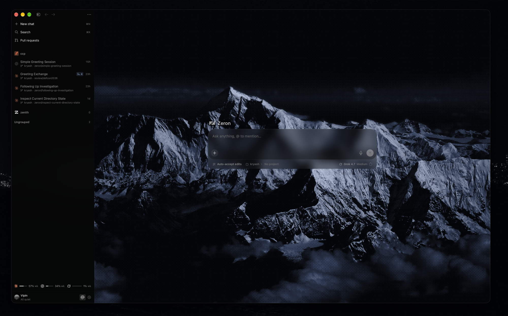

# Slate

A calm, dark template for [Zeron](https://zeron.app): a slate palette, a cleaner sidebar with plan usage, and the Himalaya at night. Very opinionated, but it works well for me.

## Install

1. In Zeron, open **Settings → Templates → Install**.
2. Paste this repository's link, or pick `slate.zeron-template` from the [latest release](../../releases/latest).
3. Allow it in the window Zeron opens, then click **Keep**. Until then it runs as a preview.

Slate's colours apply unless you've picked a theme of your own. To switch to them, choose **Slate** in Settings → Themes.

Zeron checks the link for new versions and asks before updating.

## Contributing

See [CONTRIBUTING.md](CONTRIBUTING.md).

## Credits

- Built on Zeron's interface code (MIT). See `LICENSE`.
- Wallpaper from "Mount Everest as seen from Drukair2 PLW edit.jpg" by shrimpo1967 (edit by PLW), CC BY-SA 2.0, via Wikimedia Commons. See `assets/slate/CREDITS.txt`.
